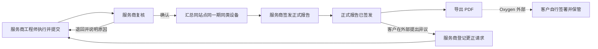

# W01-02 正常执行 退回重提与签认流程及 V1 范围

本任务以已验收的 FM200 字段为基础，描述从计划发布到报告签发、客户签证的操作、责任及验收场景。已确认的资产识别、工程师故障裁定规则立即适用。项目负责人已确认签认顺序、报告粒度和签认形式。

| 决策 | V1 规则 | 状态 |
|---|---|---|
| D1 签认顺序 | 服务商工程师提交、服务商复核确认、签发正式报告、客户在报告预留位置确认签证 | 已确认 |
| D2 报告粒度 | 保留逐设备记录；按同一客户、同一站点、同一期次、同一设备类型汇总，并覆盖该现场属于本次范围的全部同类设备 | 已确认 |
| D3 签认形式 | 服务商人员登录账号点击确认，保存当时姓名、职位、服务器时间和作用版本；客户不登录 Oxygen，在平台外签署导出的 PDF | 已确认 |

系统生成“已签发”的正式报告，并预留客户签证位置。客户下载或由服务商发送该 PDF，在 Oxygen 外完成电子或手写签署。客户签署后的 PDF 不回传 Oxygen，平台不跟踪客户是否已经签署。Oxygen 保存服务商签发的原始正式 PDF、签发记录和下载记录。

## 已确认的业务基础

本次示例 GA Code 以资产表为准，保存为参考编号。Oxygen 的 QR Code／RFID 标签关联稳定资产 ID，页面展示客户、位置及资产名称供现场核对。二维码或标签识别后仍检查账号权限。RFID 硬件兼容、读写方式及 Web 接入另行验证。

现场工程师裁定故障描述。检查表覆盖的故障直接在对应项显示异常，范围外故障写入 Remark。建议界面增加由工程师填写的“Remark 含故障异常”标记，避免仅凭文字推断结果。任一检查项异常或该标记为是，设备本次维保结果显示“有异常”。单台设备有多项故障时，设备异常数量计一台，故障条数分别展示。

异常未整改也可以提交维保记录。审核检验记录完整性、证据及描述一致性。后续整改是否完成另有记录；本次报告保留签认时的事实。发现描述疑问时退回工程师说明或修改，保存前后版本。

## 正常执行流程

| 步骤 | 操作人及入口 | 操作与校验 | 产生的记录 |
|---|---|---|---|
| 建档 | 服务商管理员，设备台账 | 预检导入，确认客户、站点和设备；绑定标签；处理同号和位置问题 | 资产 ID、导入回执、标签关系 |
| 制定计划 | 计划员，计划页 | 选设备、频率、窗口、已发布检查表版本和工程师；预览应派数 | 计划草稿及预览 |
| 发布派单 | 计划员确认，后台生成 | 同设备同一期次仅一张工单；保存当期设备清单；生成站内待办 | 已派发工单、期次及派发审计 |
| 接单核对 | 工程师，我的工单 | 识别标签，核对设备与位置；有冲突则暂停填写并反馈计划员 | 已接单及核对结果 |
| 现场填写 | 工程师，手机表单 | 填检查项、读数、照片及 Remark；短时断网保本机草稿 | 执行中草稿、上传状态 |
| 提交 | 工程师，在线提交 | 重验权限、工单版本及必填规则；所需照片上传完成；工程师确认本次记录 | 提交版本、执行人及时间，进入待服务商复核 |
| 服务商复核 | 获授权的服务商维保负责人，审核页 | 查看记录、异常、证据及历史退回理由；允许复核本人执行的记录，但不能直接改写已提交内容 | 批准或带理由退回；批准进入设备记录已复核 |
| 汇总 | 服务商维保负责人，报告批次页 | 按客户、数据中心、期次和设备类型汇总；覆盖本次范围内现场全部同类设备，逐台显示已复核、待办、取消或延期 | 草稿汇总报告及覆盖清单 |
| 服务商签发 | 获授权的服务商维保负责人，报告预览 | 核对汇总范围、异常清单、逐设备记录及未完成明细；允许签发包含本人执行记录的报告；点击确认并记录姓名、职位和时间 | 服务商对锁定报告版本的签发记录 |
| 生成正式报告 | 后台，报告中心 | 服务商签发后生成带报告编号和客户签证预留位置的 PDF；失败显示生成失败并重试 | 已签发正式报告、摘要及下载记录；Oxygen 流程完成 |
| 客户外部签证 | 客户，在 Oxygen 外 | 客户对导出的正式 PDF 在预留位置完成电子或手写签署并自行保管 | Oxygen 不接收客户已签 PDF，也不产生平台状态 |

客户签署对象是服务商已经签发并导出的正式 PDF。正式报告编号在服务商签发时分配，重复触发生成返回同一版本。客户签署、保存和流转均在 Oxygen 外完成，V1 不提供客户签证上传、归档、校验或状态追踪。

V1 要求本次汇总范围内所有同类设备都有明确处置后才能由服务商签发。设备可以是已复核、取消或延期；取消和延期必须保留原因及负责人，并在正式报告中列出。异常、正常、未执行和总范围分别计数，避免只用实际执行数掩盖覆盖不足。延期产生关联后续任务，原期次保留处置轨迹。

## 工单与报告的状态

工单主流程为已派发、已接单、执行中、待服务商复核、已复核。退回进入“待修订”，工程师修改后以新提交版本再次进入待服务商复核。取消由计划员操作，须有原因及权限。逾期根据截止时间计算，仍能按授权继续作业。报告是否已签发单独展示。

报告批次主流程为草稿、待服务商签发、生成中、已签发。服务商在签发前退回时进入待修订。客户在平台外提出异议时，由服务商获授权人员在 Oxygen 登记更正请求，再决定说明、退回设备记录或发起报告修订。生成失败只改变文件生成状态，已取得的服务商签认仍绑定原内容。

服务商签认保存操作者账号、当时姓名、职位、所属组织、客户、作用对象及版本、动作、服务器时间和意见。服务商确认在登录且有授权的情况下进行，姓名和职位采用确认当时的快照。客户签证完全在 Oxygen 外管理，平台不保存客户签证信息或文件。

## 退回 重提和更正

| 情形 | 谁处理 | 如何重提 | 历史与签认 |
|---|---|---|---|
| 检查项缺内容或照片不清 | 服务商维保负责人写原因，可定位检查项；工程师补充 | 生成新提交版本，再交服务商复核 | 保留旧提交及退回理由 |
| Remark 描述含糊 | 复核人要求说明，工程师裁定描述 | 修订 Remark 及异常标记后重提 | 新记录展示修改原因及版本 |
| 客户对已签发报告提出异议 | 客户在平台外反馈；服务商获授权人员在 Oxygen 登记设备、范围及原始反馈位置 | 受影响设备重新复核，建立汇总修订版并由服务商重新签发 | 原正式报告和异议保留；修订版重新导出供客户处理 |
| 客户质疑范围或版式 | 服务商登记客户反馈；计划员修订范围说明或版式，服务商检查 | 建立新的汇总修订版 | 已复核且内容未变的设备记录可继续引用 |
| 已签发报告需要更正 | 授权负责人发起更正并说明原因；必要时由工程师修订 | 按原要求重新复核，由服务商签发修订版 | 原报告保留并标明被哪版替代；平台不处理客户已签副本 |
| 改派或撤权时手机仍有草稿 | 计划员确认新负责人；服务器拒绝旧权限提交 | 新负责人基于已同步的有效数据核对并继续 | 原草稿及执行来源可追溯；本机未传资料按授权交接 |

提交后的内容锁定。两名复核人同时操作时只接受第一个有效状态变更，第二人刷新后看到已处理结果。更改待签认内容须建新版本，旧页面提交确认时提示版本已更新。报告预览标记草稿；服务商签发后技术内容固定；客户只在导出的 PDF 预留位置签署。技术内容需要变化时创建修订版。

## V1 范围

| 模块 | 本版交付与验收边界 |
|---|---|
| 客户与授权 | 一个客户可有多个数据中心；服务商人员可获客户全部数据中心或指定数据中心授权；末端客户不登录 Oxygen。W01-03 细化角色矩阵 |
| 台账与标签 | 单条和 CSV 录入、导入预检、位置及状态历史、QR 标签绑定与扫码查找；保存 RFID 标识并在选定读写器后验证接入 |
| 检查表 | 固定类型字段、版本发布、单位和取证要求；负责人在开发前提供已批准的必填及阈值 |
| 计划与派单 | 一次性、周、月、季；预览、窗口、负责人、站内待办、暂停、改期、改派、取消和补跑 |
| 手机执行 | 接单、设备核对、检查项、Remark 故障、照片及上传重试、短时保稿、在线提交、冲突提示 |
| 复核与签认 | 服务商退回及复核、登录确认和正式签发；允许同一账号兼任执行、复核和签发；客户在平台外签署并保管导出的 PDF |
| 报告 | 逐设备记录；按站点、期次、设备类型覆盖全部同类设备的汇总 PDF；异常、照片、服务商签认、客户签证预留位置、版本和修订 |
| 运维与验收 | 审计、备份恢复、错误告警、双客户隔离和业务链回归；上线目标沿用架构方案 |

后续迭代安排完整整改闭环、备件、采购、合同成本、DCIM／BMS 接入及整班离线。V1 对异常保留内容和跟进说明，整改闭环在后续版本补齐。RFID 硬件采购与适配工作量在选型后估算，纳入实施排期。

## 验收场景

1. 正常设备。扫码定位本客户工单，填写全部必填项并传图，工程师提交、服务商复核；同批全部同类设备有明确处置后，服务商签发正式报告。客户在外部签署并保管 PDF，Oxygen 的报告状态保持已签发。
2. 检查项内故障。工程师将面板项标为异常，描述进入设备结果和报告异常清单；故障尚未整改也能按真实记录签认。
3. 检查项外故障。全部检查项正常，工程师在 Remark 写范围外故障并标记，设备显示有异常，报告可见该 Remark。
4. 普通备注。Remark 只记录一般说明且工程师未标故障，检查项全部正常时结果保持正常。
5. 服务商退回。照片模糊定位到检查项，工程师补图形成第二版；旧提交和退回意见仍可查。
6. 客户异议。客户在平台外对已签发报告中的一台设备提出异议，服务商在 Oxygen 登记更正请求；受影响记录修订重审，服务商签发汇总修订版并重新导出；其他未变的已复核记录可继续引用。
7. 汇总对账。同站点、同一期、同一设备类型的现场全部设备必须进入覆盖清单。99 台样例中 17 台异常、82 台正常时合计为 99。若一台另含第二条故障，异常设备仍计 17；取消或延期设备单列并与实际执行基数区分。
8. 重复和冲突。双击提交、并发复核、重复生成不增加有效版本；旧页确认新版内容被拒绝并提示刷新。
9. 标签更换及权限。更换标签后历史工单可追溯；仅获 A 客户授权的服务商账号扫描 B 客户标签时，无法取得详情或下载报告。
10. 正式更正。修订带原因，由服务商重新签发；Oxygen 可取回新旧服务商正式 PDF，不保存客户已签 PDF。

这些是待实现的验收场景。W01-02 验收要求负责人确认流程及 V1 范围，并能按场景 2、3、5、6 解释每一步由谁操作、记录进入哪个版本。
